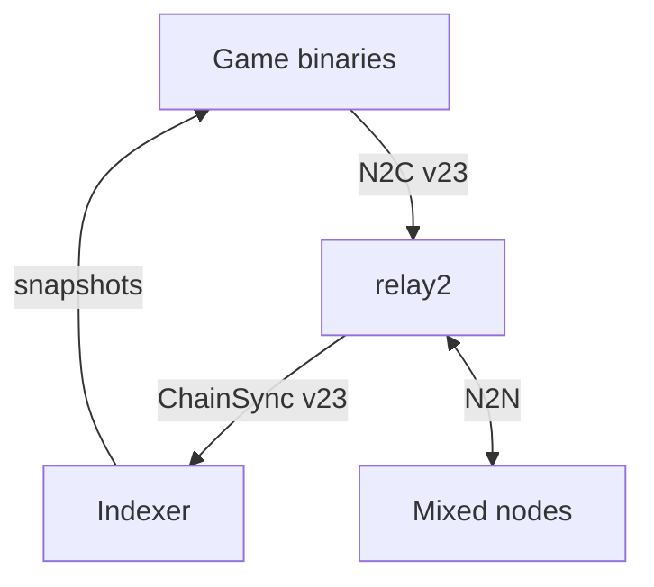

# Asteria Game

As a testnet operator, add this workload to play the [asteria][asteria] game
inside the cluster and observe whether real game transactions succeed. It drives realistic transaction
traffic - script spends, minting policies, reference scripts, validity
bounds, inline datums - so Antithesis can explore node behavior under
real ledger pressure instead of only empty-block production.

This component is part of the phase-1 gatherer feature ([#56][issue-56]).

## Adding asteria-game to a testnet

Drop the asteria-game container into any testnet's
`docker-compose.yaml` to give Antithesis a real workload generator on
top of an idle Cardano cluster. The container bundles a long-lived
utxo-indexer plus three short-lived binaries fired by composer
scripts (bootstrap, player, invariant) — see
[the why-it's-here section in the master testnet doc][master-why]
for the rationale.

### Pre-requisites

The host testnet must already have:

- A relay supporting node-to-client protocol v23, such as `relay2`
  (cardano-node 10.7.1) in the mixed-version release network, with a
  named volume mounted at `/state` so the asteria-game container
  can read its node socket. The release testnet uses
  `relay2-state:/state`.
- A `utxo-keys` named volume populated by the configurator with
  the genesis wallet skeys (the bootstrap binary needs them to
  sign the deploy tx).
- A network magic of `42`. Other magics are not currently wired —
  `NETWORK_MAGIC` is hard-coded in the player's compose env.

### Compose block

Add this service block under `services:` at the bottom of your
`docker-compose.yaml`:

```yaml
  asteria-game:
    image: ghcr.io/cardano-foundation/cardano-node-antithesis/asteria-game:<tag>
    container_name: asteria-game
    hostname: asteria-game.example
    environment:
      INDEXER_SOCK: /tmp/idx.sock
      CARDANO_NODE_SOCKET_PATH: /state/node.socket
      NETWORK_MAGIC: "42"
    volumes:
      - relay2-state:/state:ro            # read-only N2C socket
      - utxo-keys:/utxo-keys:ro           # genesis skeys for bootstrap
      - asteria-game-db:/idx-db           # RocksDB persistence
      - asteria-deploy:/asteria-deploy    # per-deploy seed TxIn
    tmpfs:
      - /tmp                              # holds /tmp/idx.sock
    depends_on:
      relay2:
        condition: service_started
```

Then declare the two new named volumes under the top-level
`volumes:` block:

```yaml
volumes:
  # … existing volumes …
  asteria-game-db:
  asteria-deploy:
```

`<tag>` is a 7-char short SHA from a commit on this repo. The
`publish-images` workflow rebuilds the image and pushes
`asteria-game:<short-sha>` whenever a commit touches
`components/asteria-game/`. Pick the tag from any green
`publish-images` run on `main`, or use the digest pinned by master
in [`testnets/cardano-node-releases/docker-compose.yaml`][master-compose].

The composer scripts that drive the binaries are baked into the
image at build time at `/opt/antithesis/test/v1/asteria-game/` - nothing extra
to mount. The Antithesis composer mounts that path into its execution
sandbox automatically when the test runs.

### Validation gate before merging into a scheduled testnet

Per the project's "no broken container on main testnet" rule, a
new testnet that adds asteria-game must dispatch a 1h Antithesis
run via `workflow_dispatch` on the feature branch and confirm
`findings_new ≤ baseline` before merging. The same gate applied
when promoting asteria-game into [`cardano_node_master`][master-pr-128].

### What does the cluster need to look like

The asteria-game player drives `spawnShip` Plutus transactions
that consume + replace the asteria UTxO. The cluster needs:

- At least one block producer that accepts valid Plutus v3
  transactions (the asteria validators are Aiken-compiled to
  PlutusV3).
- A relay serving N2C v23 through `relay2-state:/state/node.socket`.
  The game and indexer use this shared Unix socket; peer-to-peer topology
  remains the node network's responsibility.
- Genesis funds in `utxo-keys/genesis.3.skey` sufficient for the
  one-time bootstrap deploy plus a few thousand `spawnShip`
  transactions over a 3h run.

The release testnet meets all three by construction. New testnets
that change the topology, network magic, or genesis layout will
need to mirror those choices.

The clients and builder use the dependency set resolved by cardano-node
11.2.0. Both indexer ChainSync and game queries/submission offer N2C v23.
The release network retains its older nodes; Asteria uses the compatible
relay2 socket. A v20-only socket cannot make this image ready.



The game submits through relay2 and observes indexed snapshots. Relay2
connects that workload to the rest of the node network.

## What it does

The container entrypoint is a long-lived `utxo-indexer` connected to
`relay2` via N2C. The image also ships three short-lived binaries that
the Antithesis composer fires as commands:

- **`asteria-bootstrap`** - serial, idempotent deploy. Picks or reuses
  a deploy seed UTxO, parameter-applies the validators to that seed,
  mints the one-shot `asteriaAdmin` NFT, and locks the initial
  `AsteriaDatum` at the asteria spend address. Re-running is safe:
  once the asteria UTxO exists, bootstrap observes it and skips the
  mint path.
- **`asteria-game`** - parallel workload pass. Reads the asteria UTxO
  through the indexer, plans a move for one of three logical players,
  and today lets player 1 build, sign, and submit a `spawnShip` Plutus
  transaction. The binary exits after one pass; composer provides the
  repetition and concurrency.
- **`asteria-invariant`** - one-shot oracle. Depending on
  `ASTERIA_INVARIANT`, checks either the `asteriaAdmin` singleton or
  end-of-run state consistency between the asteria `ship_counter` and
  the `SHIP*` tokens at the spacetime address.

Composer scripts under `/opt/antithesis/test/v1/asteria-game/`:

| Script | Role |
|--------|------|
| `serial_driver_asteria_bootstrap.sh` | Exclusive bootstrap/deploy command. |
| `parallel_driver_asteria_player.sh` | Concurrent workload command; one observe/spawn pass. |
| `parallel_driver_heartbeat.sh` | Indexer readiness probe during the run. |
| `anytime_asteria_admin_singleton.sh` | Periodic singleton invariant. |
| `eventually_alive.sh` | Post-fault indexer liveness probe. |
| `eventually_asteria_consistency.sh` | Post-workload game-state consistency snapshot. |
| `helper_sdk.sh` | Shared shell SDK emitter and signal-safe wrapper. |

## Assertions

Asteria contributes both workload and oracles:

- `asteria_bootstrap_asteria_created` / `asteria_bootstrap_already_deployed`
  prove deployment either happened or was observed.
- `asteria_player_ship_spawned_1` proves real Plutus spawn
  transactions landed.
- `asteria_admin_singleton` is an `Always` property: exactly one
  `asteriaAdmin` NFT exists at the asteria spend address.
- `asteria_state_consistent` is a `Sometimes` property comparing
  `ship_counter` to `SHIP*` token count.
- `asteria_game eventually_alive holds` proves the long-lived indexer
  is responsive and close to the chain tip.

## Build the image

### Nix

```bash
cd components/asteria-game
nix build .#docker-image
docker load < result
version=$(nix eval --raw .#version)
docker tag \
    ghcr.io/cardano-foundation/cardano-node-antithesis/asteria-game:$version \
    ghcr.io/cardano-foundation/cardano-node-antithesis/asteria-game:dev
```

`just load-docker-image` wraps the same steps. To build all game binaries
through the component's development shell, run:

```bash
nix develop .#ci -c cabal build all -O0
```

The default shell adds the editor server; the CI shell uses the same
application dependencies and native linters without that optional tool.
The image publication workflow also checks this Cabal build.

## Run locally

```bash
INTERNAL_NETWORK=false docker compose \
    -f testnets/cardano-node-releases/docker-compose.yaml up -d
```

The compose file declares one `asteria-game` service. Its main process
is the indexer; the Antithesis composer invokes the baked-in scripts
inside that container during a test run.

For a local container smoke, first require a ready indexer whose processed
slot advances. This fails when the socket handshake or chain following is
broken, even if the container remains running:

```bash
nix run .#check-asteria-ready -- asteria-game 120
```

Then exercise the game:

```bash
just logs asteria-game
docker compose -f testnets/cardano-node-releases/docker-compose.yaml \
    exec asteria-game /bin/asteria-bootstrap
docker compose -f testnets/cardano-node-releases/docker-compose.yaml \
    exec asteria-game /bin/asteria-game
```

Inspect the emitted SDK JSON in `/tmp/sdk.jsonl`: bootstrap must report
`asteria_bootstrap_asteria_created` or `asteria_bootstrap_already_deployed`;
player 1 must report `asteria_player_ship_spawned_1`. The player event means
the node accepted submission. Confirm inclusion separately with the
consistency checker after a block is forged: its `ship_counter` and
`ship_token_count` must both increase, and the admin singleton must stay one.
A zero process exit can also mean deferred work; it is insufficient evidence.
All three game executables use the threaded runtime required by N2C timers.

## See Also

- License: see LICENSE
- Contributing: see CONTRIBUTING.md
- Other projects by [HAL][HAL]
- Other projects by the [Cardano Foundation][CF]
- About [Cardano][Cardano]

<!-- MARKDOWN LINKS & IMAGES -->

[asteria]: https://github.com/txpipe/asteria
[asteria-onchain]: https://github.com/txpipe/asteria/tree/main/onchain
[issue-56]: https://github.com/cardano-foundation/cardano-node-antithesis/issues/56
[master-why]: ../testnets/cardano-node-releases.md#why-asteria-game-is-here
[master-compose]: https://github.com/cardano-foundation/cardano-node-antithesis/blob/main/testnets/cardano-node-releases/docker-compose.yaml
[master-pr-128]: https://github.com/cardano-foundation/cardano-node-antithesis/pull/128
[HAL]: https://github.com/cardano-foundation/hal
[CF]: https://github.com/cardano-foundation
[Cardano]: https://cardano.org/
